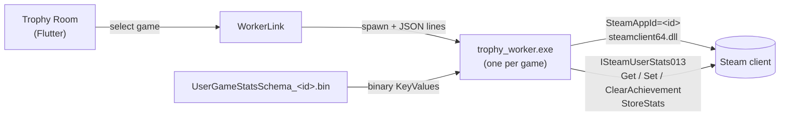

<div align="center">


# Trophy Room

**A fast Steam achievement manager.** Unlock or lock achievements for the games on your account —
with an instant, fully offline game list and a clean modern interface.


[Features](#-features) · [Install](#-install) · [Using it](#-using-it) · [Why it is fast](#-why-it-is-fast) · [How it works](#-how-it-works) · [Limits](#-limits--warning) · [Build](#-build-from-source) · [Türkçe özet](#-türkçe-özet)

</div>

---

## ✨ Features

| | |
|---|---|
| ⚡ **Instant game list** | No 40,000-game download, no thousands of ownership checks — it reads what Steam already cached on disk |
| 🖼️ **Covers & icons** | Game covers (Steam's local cache, CDN fallback), achievement icons for locked / unlocked states |
| 🧾 **Queued changes** | Ticking a box writes nothing. A bar shows *N changes pending*; press **Apply** (`Ctrl+S`) to write them in one go, or **Undo** |
| 🔎 **Search & filters** | `Ctrl+F` focus, *locked only*, *hidden*, unlock / lock / invert everything visible |
| 📊 **Progress** | Per-game unlocked count and progress bar |
| 🙈 **Hidden achievements** | Marked with an eye icon |
| 🌍 **TR / EN** | Achievement titles follow the language you choose |
| 🛡️ **Safe by default** | First-run notice, no automatic writes, real state is re-read from Steam after every apply |

## 📦 Install

**Installer (recommended)** — download `TrophyRoom-Setup-<version>.exe` from [Releases](../../releases). It installs per-user
(no admin rights), adds a Start-menu entry and warns you if Steam is missing.

> Requirements: Windows 10 / 11 (64-bit) and the **Steam client running and signed in**.

## 🚀 Using it

1. Start Steam and sign in. **Close the game** you want to edit — Steam may refuse writes while it runs.
2. Open Trophy Room. Games with achievements are listed on the left (installed ones first, marked with a green dot).
3. Click a game. Its achievements load on the right.
4. Click rows (or the circles) to mark what should be **unlocked**. Yellow-outlined rows are pending changes.
5. Press **Apply** (`Ctrl+S`). The result bar tells you how many changes Steam accepted.

| Shortcut | Action |
|---|---|
| `Ctrl+F` | Focus game search |
| `Ctrl+S` | Apply pending changes |

> **Game missing from the list?** Steam only writes an achievement schema after the game has been opened once. Launch it in Steam,
> then press *Refresh library*.

## ⚡ Why it is fast

Classic tools download `gib.me/sam/games.xml` (≈ 40,000 AppIDs) and then ask Steam *"do I own this?"* for each one.
Trophy Room skips all of that:

```
<Steam>/appcache/stats/UserGameStatsSchema_<appid>.bin
```

Steam writes one such file for every game with achievements that your account has seen. Listing that folder answers *"which games
have achievements?"* instantly, offline. Names come from `appmanifest_<appid>.acf` (installed games) or the Steam client's own
metadata (`ISteamApps001::GetAppData`).

## 🧠 How it works



* Trophy Room loads Steam's own **`steamclient64.dll`** through `dart:ffi` and calls `ISteamUserStats` by vtable index
  (`lib/steam/steam_client.dart` documents the interface versions and why indexes can shift).
* `steamclient64.dll` locks onto the AppID of the **first** pipe in a process. Switching games inside one process is impossible, so
  every selected game runs in its own helper (`trophy_worker.exe`) and the UI talks to it with JSON lines. **`trophy_room.exe` and
  `trophy_worker.exe` must sit side by side** (the installer and `tool\build.ps1` do this).
* Schemas are decoded by a small binary-KeyValues parser (`lib/steam/key_values.dart`, `schema.dart`).
* Pending changes live in `AppState`; *Apply* sends one `StoreStats` and then **re-reads** the real state from Steam so the screen
  always shows what Steam actually accepted.

## ⚠️ Limits & warning

* Windows only · achievements only (no stat counters) · games without a cached schema do not appear.
* Changing achievements by hand leaves a **permanent trace on your Steam profile**, and some games' community rankings notice it.
  Use it on your own account and know what you are doing.
* Unofficial; **not affiliated with Valve**. "Steam" is a trademark of Valve Corporation.

## ❓ FAQ

<details><summary><b>Is it the same as SAM?</b></summary>
Same job (Steam Achievement Manager), different implementation: no game-list download, a modern UI, queued changes and a worker-per-game design.
</details>

<details><summary><b>"Steam refused the write"</b></summary>
Close the game completely and try again. Games running through Steam can block outside writes.
</details>

<details><summary><b>"Schema is not in the Steam cache"</b></summary>
Launch the game once in Steam so it downloads the schema, then refresh the library.
</details>

<details><summary><b>Where is my data?</b></summary>
Only the language and the first-run notice are stored, in <code>%APPDATA%\TrophyRoom\prefs.json</code>. Nothing else is written, and the app has no network features beyond loading images from Steam's CDN.
</details>

## 🔧 Build from source

Requirements: [Flutter](https://docs.flutter.dev/get-started/install/windows) (Windows desktop), Visual Studio **Desktop development with C++**.

```powershell
git clone https://github.com/GingerSugar06/TrophyRoom.git
cd TrophyRoom
flutter pub get
flutter test
powershell -ExecutionPolicy Bypass -File tool\build.ps1     # worker + app → build\windows\x64\runner\Release\
```

**Development:** `dart compile exe bin/trophy_worker.dart -o build/trophy_worker.exe`, then `flutter run -d windows`.
**Installer:** `powershell -ExecutionPolicy Bypass -File tool\make_installer.ps1` (needs [Inno Setup 6](https://jrsoftware.org/isinfo.php)).
**Icon:** edit `assets/icon/app_icon.svg` or drop `assets/icon/source.png`, then `python tool/make_icon.py`.

### Project layout

```
TrophyRoom/
├─ bin/trophy_worker.dart     helper process: one game, JSON lines over stdio
├─ lib/
│  ├─ main.dart               window, shortcuts, shell
│  ├─ app_state.dart          library, selection, pending changes, apply
│  ├─ library_scan.dart       instant game list (isolate)
│  ├─ worker_link.dart        process bridge to the worker
│  ├─ steam/                  steamclient FFI, schema + KeyValues parsers, Steam paths
│  ├─ ui/                     games pane, achievements pane, theme
│  ├─ l10n.dart / prefs.dart  TR/EN, tiny preferences
├─ installer/                 Inno Setup script
└─ tool/                      build.ps1, make_installer.ps1, make_icon.py
```

## 🤝 Contributing

Issues and PRs are welcome — run `flutter analyze` and `flutter test` first.

## 🇹🇷 Türkçe özet

**Trophy Room**, hesabındaki oyunların Steam başarımlarını açıp kapatan hızlı bir Windows uygulamasıdır. Oyun listesi ağa hiç
çıkmadan, Steam'in diske yazdığı şemalardan **anında** gelir. Kutulara basmak hemen yazmaz; değişiklikler biriktirilir ve **Uygula**
(`Ctrl+S`) ile tek seferde Steam'e gönderilir. Steam açık ve oturum açılmış olmalı; düzenlediğin oyunu kapat. Başarımları elle
değiştirmek profilinde kalıcı iz bırakır — kendi hesabında, ne yaptığını bilerek kullan.

## ⚖️ License

[MIT](LICENSE). Font: Poppins (SIL OFL 1.1). Unofficial project; not affiliated with Valve.
